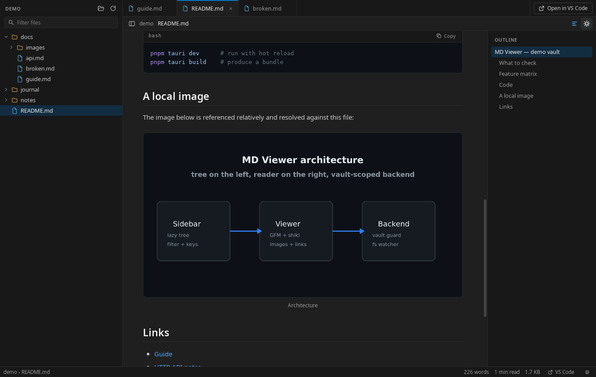

# MD Viewer


[](https://github.com/Dominga/md-viewer/releases)

A fast, read-only Markdown viewer for local folders — a VS Code-like tree on
the left, a clean reading surface on the right. Built with Tauri 2, React and
Rust, so it stays a small native window instead of a browser tab.



## Why another Markdown viewer?

Because reading notes should not require starting an IDE or a browser. MD
Viewer opens a folder, renders GitHub-flavored Markdown, resolves local images
and links against the vault, and gets out of the way. It never writes to your
files: editing is delegated to whatever editor you already use.

## Features

- **Vault tree** — lazy-loading directories, filter, keyboard navigation,
  reveal the active file, remembered state between launches.
- **Tabs and breadcrumbs** — one tab per file, per-tab scroll position, quick
  switching with `Ctrl+W` to close.
- **GitHub-flavored Markdown** — tables, task lists, strikethrough, autolinks,
  footnotes and raw HTML (sanitized).
- **Code highlighting** — Shiki with GitHub themes, a copy button, and a
  language label on every block.
- **Local images with liveness checks** — relative and vault-absolute paths are
  resolved against the document; missing files render an explicit placeholder
  instead of a broken icon; clicking opens a lightbox.
- **Image previews for links** — a link that points at a local, existing image
  gets a small thumbnail, and opens in the image tab.
- **Live reload** — a filesystem watcher refreshes the tree and any open file.
- **Outline panel** — headings with scroll-spy, click to jump.
- **Open in editor** — auto-detects VS Code, Cursor, Zed, Sublime, Kate and
  friends; override with `$MDV_EDITOR`.
- **Light and dark themes**, session restore, and a CLI that can deep-link into
  a single note.

## Download

Prebuilt bundles live on the [releases page](https://github.com/Dominga/md-viewer/releases/latest):

| Platform | Packages |
| --- | --- |
| Linux | `.deb`, `.rpm`, `.AppImage` |
| Windows | `.msi`, NSIS `.exe` |

Installing the `.deb` or `.rpm` adds MD Viewer to the application menu and
registers it as a viewer for `.md` files (`text/markdown`).

The builds are unsigned: Windows SmartScreen warns on first launch, and the
AppImage needs `chmod +x` before running. Versions are bumped automatically on
every merge to `main` — the `Release` workflow derives the next number from the
existing tags, builds both platforms and publishes the artifacts.

## Requirements

### Runtime

- Linux: `webkit2gtk-4.1`, `libgtk-3`, `libsoup-3`
- Rust 1.77+ and Node.js 20+ for building

On Debian/Ubuntu:

```bash
sudo apt install libwebkit2gtk-4.1-dev libgtk-3-dev libsoup-3.0-dev \
  build-essential curl wget file libssl-dev librsvg2-dev
```

### Build

```bash
pnpm install
pnpm tauri dev      # development, hot reload
pnpm tauri build    # release bundle (.deb, .AppImage, ...)
```

## Usage

```bash
md-viewer ~/notes                 # open a folder
md-viewer ~/notes docs/guide.md   # open a folder and a file inside it
md-viewer ~/notes/today.md        # open the parent folder and that file
```

Inside the app, `Ctrl+O` opens another folder. The chosen folder becomes the
*vault root*: every path is validated against it on the Rust side.

### Troubleshooting

If the window opens but stays blank on Linux — most often with NVIDIA
drivers — run the app with the DMA-BUF renderer disabled:

```bash
WEBKIT_DISABLE_DMABUF_RENDERER=1 md-viewer ~/notes
```

On a headless machine, `xvfb-run -s "-screen 0 1600x1000x24" md-viewer ~/notes`
works as well; screenshots in this repository were taken that way.

## Keyboard shortcuts

| Shortcut | Action |
| --- | --- |
| `Ctrl+O` | Open folder |
| `Ctrl+B` | Toggle sidebar |
| `Ctrl+W` | Close the active tab |
| `Ctrl+E` | Open the active file in the editor |
| `Ctrl+L` | Toggle the outline |
| `↑` / `↓` | Move in the tree |
| `→` / `←` | Expand / collapse a folder |
| `Enter` | Open the selected entry |
| `Esc` | Close the lightbox |

## Configuration

| Variable | Description |
| --- | --- |
| `MDV_EDITOR` | Editor command used by **Open in editor**, e.g. `code -g` or `kate`. Without it the button uses the system default application for `text/plain` — Kate on KDE, Notepad on Windows, TextEdit on macOS — then `$VISUAL`/`$EDITOR` (GUI editors only), then a built-in list of common editors. |

## Project layout

```
src/                React UI
  components/       sidebar, tabs, viewer, markdown renderer
  lib/              IPC wrappers, path resolution, assets, highlighting
  state/            zustand store (session, tabs, docs)
src-tauri/          Rust backend
  src/state.rs      vault state, path guard, filesystem commands
  src/watcher.rs    debounced recursive filesystem watcher
  src/editor.rs     editor detection and launch
demo/               sample vault used for manual testing and screenshots
docs/               architecture notes
```

See [docs/ARCHITECTURE.md](docs/ARCHITECTURE.md) for the design decisions
behind path handling, rendering and the asset pipeline.

## Status

Early, but usable. Known gaps:

- No full-text search across the vault yet.
- No wiki-links (`[[note]]`) or backlinks.
- PDF and other binaries are handed over to the system app.
- macOS and Windows builds are untested.

## License

MIT
