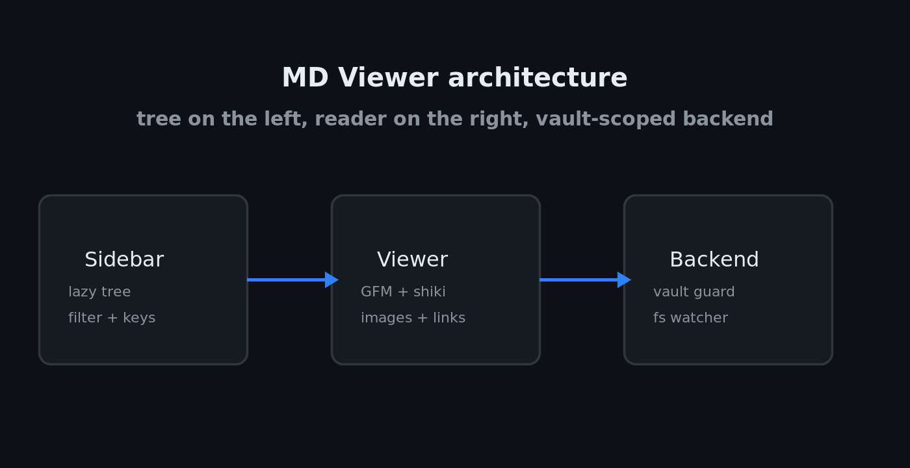

# MD Viewer — demo vault

This folder is a sample vault used to try the viewer: nested directories,
GFM extras, code highlighting, math-free tables and local images.

> Keep this folder in the repository — it doubles as a smoke test and as the
> source for the screenshots in the README.

## What to check

- [x] Sidebar tree with nested folders and lazy loading
- [x] Tabs, breadcrumbs and the outline panel
- [x] Tables, task lists and strikethrough
- [x] Local image preview with relative paths
- [x] Broken image fallback

## Feature matrix

| Area      | Status | Notes                                  |
| --------- | ------ | -------------------------------------- |
| Rendering | done   | GitHub-flavored Markdown               |
| Tree      | done   | lazy loading, filter, keyboard nav     |
| Images    | done   | relative paths, click to zoom          |
| Search    | later  | full-text search across the vault      |

## Code

```rust
/// Resolve a path inside the vault and reject anything that escapes it.
fn resolve(root: &Path, rel: &str) -> Result<PathBuf, Error> {
    let joined = root.join(rel);
    let canonical = joined.canonicalize()?;
    if !canonical.starts_with(root) {
        return Err(Error::Escape);
    }
    Ok(canonical)
}
```

```bash
pnpm tauri dev      # run with hot reload
pnpm tauri build    # produce a bundle
```

## A local image

The image below is referenced relatively and resolved against this file:



## Links

- [Guide](docs/guide.md)
- [HTTP API notes](docs/api.md)
- [Journal entry](notes/2026-11-12.md)
- [A file with a missing image](docs/broken.md)

---

*Everything here is safe to edit — the viewer reloads the file on save.*
