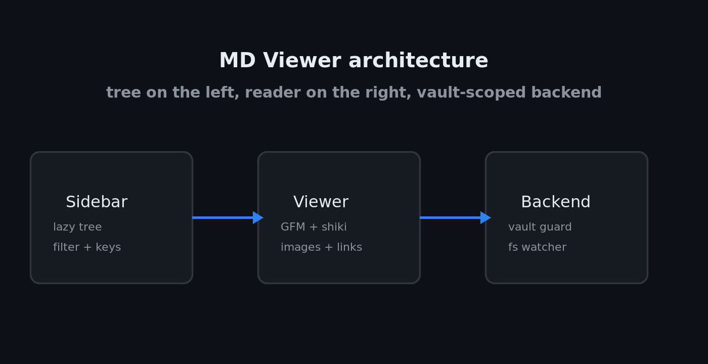

# Broken assets

This page references files that do not exist. The viewer should keep the
layout intact and show a placeholder with the path instead of a broken image
icon.

## Missing image

## Present image, for comparison

## Missing link

[This page does not exist](nope.md), and neither does [this one](../notes/nope.md).
