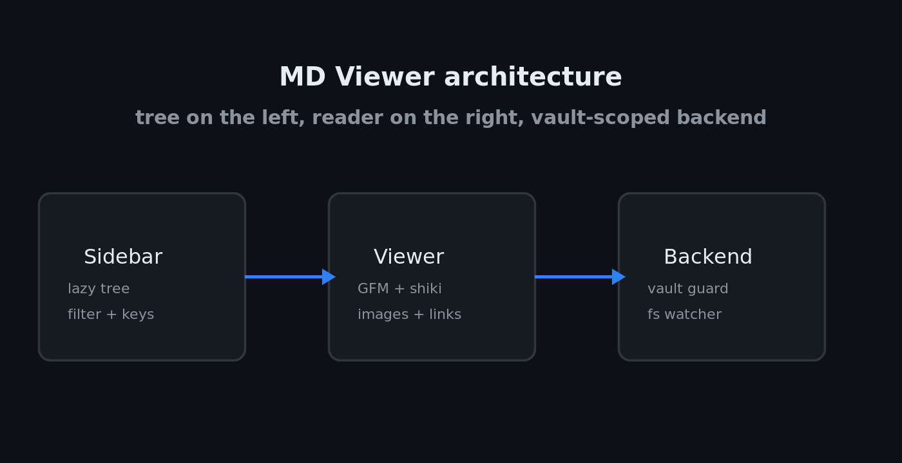

# Guide

A longer document to test scrolling, heading anchors and the outline panel.

## Getting started

Open a folder with `Ctrl+O`, pick a Markdown file in the sidebar and read it.
The viewer never writes to disk, so the only way to change a file is an
external editor — use the **Open in editor** button in the tab bar.

### Opening a vault

The folder you pick becomes the *vault root*. Every path in the UI is relative
to it, and the backend refuses anything that tries to leave it:

```ts
const file = await invoke<Doc>("read_doc", { rel: "docs/guide.md" });
```

### Keyboard shortcuts

| Shortcut           | Action                |
| ------------------ | --------------------- |
| `Ctrl+O`           | Open folder           |
| `Ctrl+B`           | Toggle sidebar        |
| `Ctrl+W`           | Close current tab     |
| `Ctrl+E`           | Open in editor        |
| `Alt+←` / `Alt+→`  | Back / forward        |

## Images

Relative paths are resolved against the document that contains them, so this
works from any depth:



Images can be clicked to open them full-size, and every image is loaded through
the backend, which means a missing file shows a readable placeholder instead of
a broken icon.

## Nested checklists

- [x] Parse GFM
- [x] Highlight code
- [ ] Ship a public release
  - [x] Build for Linux
  - [ ] Build for macOS and Windows

## Quotes

> The best interface is the one you do not have to think about.
>
> — someone, probably

## Long prose

Lorem ipsum is not very useful for layout tests, so here is a paragraph of real
text instead. A viewer is mostly a reading surface: the column should stay
narrow enough that the eye does not have to travel too far, the line height
should be generous, and the type should not fight with the code blocks. That is
why the content pane is capped at roughly 80 characters per line.

A second paragraph helps to check the spacing between blocks. Headings should
breathe, paragraphs should not run into each other, and lists should align
their bullets with the surrounding text.
