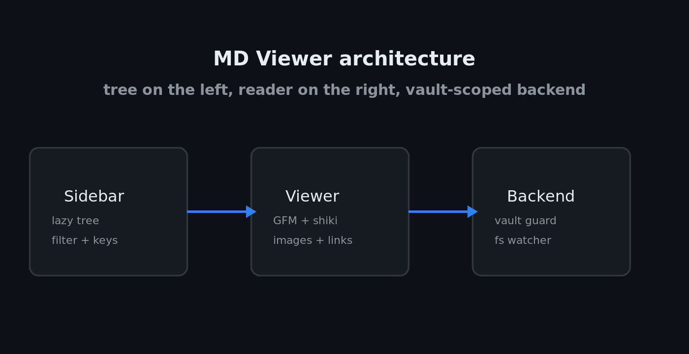

# 2026-11-12

## Morning

Started sketching the viewer. The main decision was to keep it read-only:
no editor, no dirty state, no autosave. Instead there is an **Open in editor**
button that hands the file to whatever is installed.

## Links to test

- Up to the [README](../README.md)
- To the [guide](../docs/guide.md)
- To a [missing page](missing.md)

## Idea

> A viewer should be instant. If a file takes more than a frame to render,
> the tree should still feel responsive.

- [ ] Try the outline panel with a long file
- [x] Check that the tree reloads on external changes

## Image of the day

